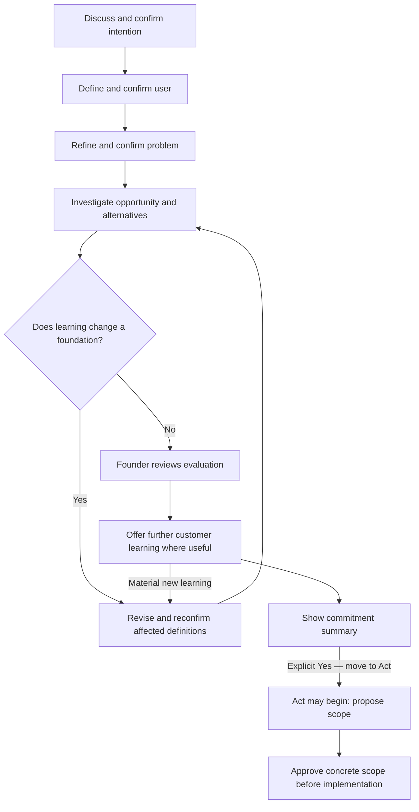

# M1-R3 — IDE before Act: proposal for approval

23 September 2026 · Proposal only · Existing Crumb repository

The change is to make building a deliberate founder decision after confirmed Intention, User, Problem and reviewed Evaluation. Deeper research alone did not fix M1-R2 because its transition rules still allowed research completion to become permission to shape an MVP.

This proposal covers A–H in your request. The five exact conversations, including the extended stock case, are in [M1-R3 conversation examples](<C:/Users/Ash/Documents/Codex/2026-09-23/you-are-continuing-development-of-my/outputs/M1_R3_CONVERSATION_EXAMPLES.md>). These are proposed interactions, not completed M1-R3 tests or real founder confirmations.

The active code, PRODUCT_SPEC.md, PLAN.md and historical reports remain unchanged. No implementation, commit or push is authorized by this document. Approval to implement M1-R3 would still leave M2 and a Git push separately unapproved.

## Repository baseline

- Existing working copy: `C:\Users\Ash\Documents\Codex\CEC`.
- Branch: `main`; working tree clean when inspected.
- Origin fetch/push: `https://github.com/ashhoque/crumb.git`.
- HEAD: `c218317a2b17d6f4a7194ef5c875b5d26ed48d48`, the M1-R2 commit. Local status reports `main...origin/main`; no fresh remote fetch was needed for this proposal.
- Read current instructions, implementation, contracts, tests, fixtures, master and plan. Recorded hashes for 109 tracked files to check preservation.
- The recorded M1-R2 result remains 140 passing tests, with founder UX acceptance pending and the previously reported host invocation limitation. No new application test result is claimed here.

## A. Why M1-R2 still advanced too early

| Actual implementation | Why the experience moves too quickly | M1-R3 correction |
|---|---|---|
| Intention is `provided`, `skipped`, etc.; User and Problem are text findings. [Current model](https://github.com/ashhoque/crumb/blob/c218317a2b17d6f4a7194ef5c875b5d26ed48d48/src/domain/prebuild.ts#L44) | Recording information can look like the founder agreed with Crumb's interpretation. There are no separate confirmations. | Confirm the exact current statement for each foundation. |
| Evaluation `ready` checks coverage, research and a synthesis. It requires a problem but does not require a separately confirmed, specific target user. [Validator](https://github.com/ashhoque/crumb/blob/c218317a2b17d6f4a7194ef5c875b5d26ed48d48/src/domain/prebuild.ts#L211) | Research completeness is treated as action readiness. There is no founder review of the evaluation or commitment checkpoint. | Separate research review, founder review and permission to enter Act. |
| The same `ready` state permits interview, MVP and master choices. [Choice guard](https://github.com/ashhoque/crumb/blob/c218317a2b17d6f4a7194ef5c875b5d26ed48d48/src/domain/prebuild.ts#L228) | “Worth shaping” becomes the next recommended build. | Interview preparation stays in IDE; MVP choices require final Act confirmation. |
| `build_requested` bypasses unfinished Intention and Evaluation. A test explicitly protects that behavior. [Application guard](https://github.com/ashhoque/crumb/blob/c218317a2b17d6f4a7194ef5c875b5d26ed48d48/src/application/prebuild.ts#L65), [test](https://github.com/ashhoque/crumb/blob/c218317a2b17d6f4a7194ef5c875b5d26ed48d48/tests/prebuild.test.ts#L102) | “Just build” can evade the proposed foundations entirely. | Supersede this escape for new guided Crumb product work. |
| A pre-Act master contains `mvpHypothesis`, `nonGoals` and `technicalStrategy`. [Master model](https://github.com/ashhoque/crumb/blob/c218317a2b17d6f4a7194ef5c875b5d26ed48d48/src/domain/prebuild.ts#L57) | Solution design can enter through optional detail even when the main reply avoids it. | Pre-Act opportunity brief; solution sections become available only after Act consent. |
| Context hashes protect pending scope from stale research, but no foundation confirmation exists to invalidate. | A changed user/problem can retain the appearance of agreement. | Track dependencies between confirmations and invalidate them on substantive changes. |
| Existing coverage and research receipts provide useful structure; fields marked unknown can satisfy completion after an attempt. | A populated checklist does not establish that the exact cohort, pain, alternatives and counterevidence received sufficient attention. | Require relevant research questions, synthesis and a challenge pass; evaluate depth semantically as well as structurally. |

This was a product-rule problem as well as a conversation problem. The tests largely verified M1-R2's intended rules, including its escape route. The historical pass should remain recorded; the new default must deliberately supersede those rules.

The old sourced stock rehearsal also emphasized a personal tool and included long-term investing discussions. Those sources cannot silently establish demand from paid, active US swing traders. Useful sources remain available, with their relevance reassessed against the confirmed user.

## B. Revised state and interaction model

### Five separate agreements

| Foundation | Internal states | What advances it |
|---|---|---|
| Intention | `unknown → drafted → founder_confirmed` | Founder agrees with the displayed goal and material constraints. |
| Target user | `unknown → drafted → founder_confirmed` | Founder agrees with the displayed initial user, behavior and situation. |
| Problem | `unknown → drafted → founder_confirmed` | Founder agrees with the displayed pain, consequence and workaround. |
| Evaluation | `not_started → researching → reviewed → founder_reviewed`; or `requires_redefinition` | Crumb investigates and shows a qualified synthesis; the founder explicitly agrees it captures the learning and uncertainty. |
| Act readiness | `not_ready → ready_for_confirmation → founder_confirmed` | After all four prerequisites, founder explicitly chooses **Yes — move to Act** at the current commitment summary. |

These labels stay internal. Normal conversation asks one useful question at a time. Existing information is reused to draft statements; an existing product does not restart onboarding. Unconfirmed or skipped information may be saved, discussed and resumed, but does not unlock the next foundation or Act. Research needed to clarify a candidate definition is allowed; completed opportunity evaluation must reference confirmed definitions.

The conversation follows:

The interview option is optional; the founder may proceed from reviewed evaluation to the commitment summary. Agreeing with a business statement is not evidence that the business is valid. Entering Act permits solution design; it does not approve an unseen implementation scope.

### Intention, User and Problem prompts

Intention explores only matters that change advice: outcome, customer preference, scale, appetite for sales/support, time/capital constraints and relevant expertise/access. Categories include personal use, solo profit, bootstrap, high growth, enterprise, acquisition, useful/open-source, learning and custom. A category alone is insufficient when material constraints are already apparent.

After a concise **My understanding of your intention**:

> **Is that the intention you want me to optimize around?**
>
> Yes · Adjust it

After **Who we're building for**, derived from actual input and research:

> **Is this the user you actually want to focus on first?**
>
> Yes · Narrow it · Different user

After **Problem we're solving**, describing situation, job, friction, consequence and current workaround:

> **Is this the exact pain you want us to solve?**
>
> Yes · Something's missing · Narrow it

No invented experience level, account size, buyer or constraint. Unknown details remain unknown. Crumb challenges solution-shaped statements with concrete behavior questions before drafting the pain.

### Evaluation and its review

Research follows questions about the confirmed user/problem, not a mandatory count of pages. The existing bounded research mechanism stays. A useful pattern is landscape and substitutes, cohort-specific pain/love/hate, then counterevidence and founder fit; these are investigative passes, not visible wizard steps.

| Investigation | Required judgment |
|---|---|
| Frequency, urgency, severity/cost, mandatory/optional work, workaround | What happens, when, and what consequence is supported? Distinguish actual behavior from hypothetical frustration. |
| Buyer, existing spend, willingness and ability to pay, business-model fit | Who pays, what already costs money/time, and what remains unknown about incremental spending? A competitor price is not willingness to pay for this product. |
| Prevalence/size, category direction, competition, switching cost | How widespread is the exact workflow, what alternatives already work, and what must a customer give up? No unsupported market-size number. |
| Founder insight, expertise, access/distribution, reachability | Why can this founder understand and reach these users? Separate capability from self-reported access and an untested acquisition route. |
| Technical feasibility, generic AI substitution, dedicated value | What constraints could make this opportunity impractical or unnecessary? Discuss feasibility without designing features, architecture or a prototype. |
| Alignment with confirmed Intention | Is the likely sales, support, capital and data burden compatible with the founder's actual goal? |

Competitor coverage includes direct, adjacent and incumbent products, AI entrants, services, spreadsheets/manual work, generic AI and doing nothing. Meaningful alternatives receive user/positioning/workflow/pricing, strengths, praise/complaints, gaps, complexity/onboarding, distribution, switching and underserved-user analysis. Unavailable information is labeled, not filled with plausible prose.

Love/hate is prominent: what users value, resent, tolerate, build themselves and still perform manually. A repeated theme must identify independent observations and cohort relevance. Cosmetic preferences are separated from consequences. Search frustrated-user language in relevant permitted public sources, and look for satisfied users and adequate substitutes too.

Revenue, users/customers and funding remain attributed reported facts with dates and definitions. Hiring, releases, review growth, integrations, traffic estimates, GitHub activity and similar signals remain proxies. Funding does not prove demand; a release does not prove revenue or a regular shipping cadence; missing news does not prove stagnation. Shutdown/layoff claims need their own sources.

The habitat map derives from the actual user. It identifies a few credible online, professional or physical avenues, with observed relevance, access route and limits. “People discuss this there” does not mean posting, promotion or contact is permitted. No outreach occurs automatically.

Compare at most two nearby problems when evidence makes comparison useful. Explain stronger/weaker pain, founder fit, reachability, learning cost and any existing assets that might be reusable. Do not invent a pivot or design the adjacent solution.

Before marking `reviewed`, relevant dimensions have findings or justified unknowns backed by relevant attempts, core investigations are present, contradictory evidence has been examined, and the synthesis explains what changes the decision. An unavailable tool, exhausted budget, two unproductive searches or a blanket list of unknowns does not itself complete Evaluation. Stop the run honestly; broaden a weak query, investigate a decision-critical gap in a bounded follow-up, or retain an incomplete evaluation. A well-investigated opportunity can still have uncertain demand.

Once the synthesis is ready, ask a natural review question such as:

> My read is that the workflow is plausible, but separate willingness to pay is still unproven. Does that fairly capture what we've learned and the uncertainty we're carrying?
>
> Yes · Correct the assessment · Investigate further

Only an explicit response establishes `founder_reviewed`. Reading optional detail is never mandatory. Declining interviews is not evaluation approval and is not Act consent.

### Confirmation integrity and invalidation

Each confirmation attaches to the exact presented subject and its content version. Retain the displayed statement/summary, presentation identity, subject digest, founder reply, relevant turn reference and recorded time. The application creates the receipt through a confirmation transition; accepting a generic context payload with `founder_confirmed: true` must not manufacture approval.

A plain “Yes” can confirm a foundation when it responds unambiguously to that one displayed question. “Yes, but change the user…” is an edit, not approval of the old wording. The final checkpoint requires the explicit Act choice or an unambiguous equivalent such as “Yes, move to Act.” A generic “looks good,” quoted text, imported example, old assent or unrelated approval cannot unlock Act. One response does not approve multiple unseen statements.

The local core can enforce receipt structure and version binding; it cannot independently authenticate a human conversation supplied by the host. Host honesty remains a trust boundary and must be tested through actual transcripts. Synthetic confirmations stay tagged and cannot authorize live project work.

| Substantive change | Confirmation invalidated | What remains useful |
|---|---|---|
| Intention or material founder constraints | Intention, User, Problem, Evaluation review, Act | Prior statements as drafts; sources with original provenance |
| Target user, buyer or relevant cohort/workflow boundary | User, Problem, Evaluation review, Act | Confirmed Intention; potentially reusable sources |
| Problem, consequence or material workaround | Problem, Evaluation review, Act | Confirmed Intention and User |
| Decision-relevant evidence, contradiction or feasibility/economics assessment | Evaluation review and Act; also affected definitions if redefinition is required | Unchanged confirmed foundations and historical sources |
| Preferred display name, opening optional detail, purely presentational formatting | None | All current confirmations |

Use conservative content comparisons rather than a model-controlled “nonmaterial” flag. Reconfirm changed meaning; do not repeatedly reconfirm unchanged foundations. Every evaluation records the foundation versions it evaluates. A research-driven candidate change enters `requires_redefinition`; it is not silently accepted. Historical approvals remain inspectable while current readiness is revoked.

### One final commitment summary

Show Intention, User, Problem, two or three evidence-backed reasons and the biggest remaining unknown. Use an explicitly supplied preferred name occasionally, never one inferred from usernames or paths.

If no preferred name is known, Crumb may ask once at a natural moment. The answer is optional, declining does not trigger repeated requests, and IDE continues without it.

> **Ready to commit a build cycle to this?**
>
> Yes — move to Act · Change the user · Change the problem · Review evaluation

This checkpoint is the explicit four-choice exception to the usual two or three choices. Merely displaying it leaves Act locked. Choosing a change revisits the relevant definition. Reviewing details grants no consent. A material update after the summary makes its confirmation stale.

An early “just build” gets a concise acknowledgement and the next unresolved foundation. It does not create a hidden escape. This supersedes M1-R2's guided build bypass and conflicting repository guidance. Crumb must not disguise the same work as a portable handoff or legacy action to evade the gate. Ordinary coding outside a Crumb-guided product decision is outside this policy; it must not be automatically used as a workaround inside the guided experience.

## C–D. Exact conversation examples

The [companion document](<C:/Users/Ash/Documents/Codex/2026-09-23/you-are-continuing-development-of-my/outputs/M1_R3_CONVERSATION_EXAMPLES.md>) contains:

1. A vague B2B idea refined without an early feature list.
2. An existing product that preserves its code and starts from known context.
3. Existing feedback that changes the problem and invalidates readiness.
4. A full stock conversation: entry, deeper intention, all confirmations, several evaluation exchanges, a redefinition loop, interview option, evaluation review, commitment and only then scope discussion.
5. Research revealing a stronger adjacent problem, with an explicit founder choice and reconfirmation.

These are examples of natural interaction, not a fixed number of turns. If the founder already supplied the relevant facts, Crumb uses them. It still shows and confirms its interpretation.

## E. What stays in optional research

The default view contains the decision, its strongest support, the most important uncertainty and one next question. Substantial replies begin with a two-to-five-sentence Executive summary; use one to three supporting bullets when useful. Short clarification turns can be a few lines. No forced six-heading format, scores or step counter.

Before expanded material, use exactly:

> The extra detail below is optional—you can continue without reading it.

| Default conversation | Optional detail |
|---|---|
| “An apparent competitor gap has already been addressed.” | Original complaint, current official documentation, dates, conflicting claim and resulting correction |
| “Payment for a separate comparison workflow remains unproven.” | Pricing terms, observed spend, inferred buyer, evidence against incremental payment, unit-economics assumptions |
| “These are the most credible starting avenues.” | Habitat/source map, likely cohort, participation route, access uncertainty and permissions to check |
| “The stronger nearby problem may be the handoff after approval.” | At most two adjacent comparisons with evidence, founder fit and reusable existing assets |
| “This review supports a deliberate decision, with one major unknown.” | Coverage matrix, competitors, love/hate, reported metrics versus proxies, limitations, query receipts, sources and red-team notes |

Optional detail before Act contains no proposed MVP, feature specification, implementation architecture or prototype plan. Interview preparation can be generated here without creating a software action. The pre-Act opportunity brief includes foundations, research, risks, business-model hypotheses, feasibility constraints and learning questions. After Act consent, it may be extended with the approved solution work. Historic masters remain historic artifacts, never current implied permission.

## F. Proposed acceptance tests

These are planned checks, not claims of executed tests. Use disposable synthetic projects; keep network research separate from deterministic tests.

| ID | Hard assertion or reviewed behavior |
|---|---|
| R3-01 | With all other prerequisites satisfied, missing or drafted Intention rejects Act transition, action draft, approval and executable handoff. |
| R3-02 | Repeat the isolated negative case for Target user. Vague text alone is not confirmation. |
| R3-03 | Repeat for Problem. An idea or requested solution cannot stand in for a confirmed pain. |
| R3-04 | `researching` or agent `reviewed` Evaluation cannot substitute for `founder_reviewed`. |
| R3-05 | Complete IDE plus a displayed checkpoint still rejects Act without its explicit current confirmation. |
| R3-06 | A valid explicit Act choice on the exact current summary unlocks scope drafting; it does not approve the new scope or execute code. |
| R3-07 | Changing User invalidates User, Problem, Evaluation review and Act; old confirmations and pending scopes cannot be reused. |
| R3-08 | Changing Problem invalidates Problem, Evaluation review and Act; unchanged Intention/User remain confirmed. |
| R3-09 | Changing Intention or its material constraints invalidates dependent confirmations. |
| R3-10 | New decision-relevant evidence invalidates evaluation review/checkpoint. A detected redefinition blocks even if an older basis had consent. |
| R3-11 | Name changes, optional-detail reads and formatting do not erase valid substantive confirmations. |
| R3-12 | Reject fabricated status flags, wrong subject hashes, stale prompts, reused turn receipts, quoted/example assent and synthetic-to-live approval reuse. |
| R3-13 | Two sessions cannot confirm different versions concurrently. Stale expected-version writes fail without overwriting history. |
| R3-14 | “Just build,” v3/v4 requests, missing context, old `context_ready`/`evaluation_ready`, aliases and portable handoffs cannot bypass new-work guards. |
| R3-15 | Legacy history, hashes, exports, approved scope records and receipts remain readable. Old `ready` is not auto-converted to R3 confirmation. |
| R3-16 | Core evaluation coverage requires relevant attempts, counterevidence and synthesis. An unavailable run or filled unknowns cannot fake review completion. |
| R3-17 | Distinguish repeated independent user themes from anecdotes/reposts/vendor claims; catch an obsolete competitor complaint contradicted by current documentation. |
| R3-18 | Preserve reported metric/proxy distinctions, source dates, snippets, unavailable pages, uncertainty and no unsupported revenue/prevalence claims. |
| R3-19 | Before final consent, normal choices, rendered briefs, optional master and structured handoffs contain no MVP/feature/architecture/prototype recommendation. |
| R3-20 | Confirming each foundation happens in order; early research may clarify but cannot finish evaluation against unconfirmed foundations. |
| R3-21 | Interview preparation is available after established evaluation without Act; no outreach is sent, no code approval is inferred, and material feedback invalidates readiness. |
| R3-22 | One commitment summary has the exact prompt and four choices. Ordinary turns keep the normal two/three-choice limit. |
| R3-23 | All five conversation cases pass semantic review for warmth, material questions, useful depth, evidence limitations and no repeated onboarding. |
| R3-24 | Stock transcript asserts Act remains locked after every earlier turn, demonstrates redefinition/reconfirmation and emits its first solution recommendation only after explicit final assent. |
| R3-25 | Stock evaluation addresses every required category, including substitutes, love/hate, public pain, traction, gaps, adjacency, founder fit and habitats; source count alone cannot pass it. |
| R3-26 | Optional research contains the full supporting dossier, while normal chat remains concise and names have explicit provenance. |
| R3-27 | Backup/restore and export/import preserve the new state, lineage and synthetic labels without mutating existing history or trusting arbitrary imported approval in another live project. |
| R3-28 | Existing privacy, offline-core, initialization, artifact/hash, scope approval, receipt and recovery regressions remain covered with the pinned runtime. |

Apply guard tests at every executable boundary, not only the friendly CLI. Imported historical data stays readable; activating a new project or changed project identity requires current confirmations. Exact backup recovery of the same project may preserve valid receipts if identity and integrity checks pass.

Freeform host prose cannot be made semantically safe by a JSON enum or keyword blacklist alone. Deterministic gates protect state and structured actions; full transcript review must catch a feature recommendation disguised as “feasibility.” After implementation report these evidence types separately, and retain founder acceptance as a distinct status. No independent agents are required unless separately authorized.

## G. Smallest implementation change

Keep the existing TypeScript application, local SQLite store, privacy boundaries, source/provenance model, bounded host research, append-only revisions, approvals, receipts and backup support. No new service, UI framework, crawler or dependency is proposed.

| Existing area | Focused change |
|---|---|
| `src/domain/prebuild.ts` | Add a neutral version-2 prebuild contract for confirmed foundations, evaluation basis/review, final commitment and dependency invalidation. Preserve version-1 validation for history. Extend missing evaluation dimensions and represent alternative coverage without forcing invented competitors. |
| `src/application/prebuild.ts` | Centralize present/confirm/revise transitions and derived readiness. Retain expected-version writes, hash checks and immutable revision behavior. Generic saves cannot set confirmation receipts. |
| `src/domain/contracts.ts` | Add a neutral version-5 action contract referencing current IDE basis and Act receipt. Preserve versions 1–4 as historical contracts. |
| `src/application/workflow.ts` | Apply the same current readiness guard when creating, approving and handing off new guided work. Preserve approved historical records; do not treat an old record or export as fresh permission to start an unstarted build. Keep the later scope-approval guard. |
| `src/cli/main.ts`, rendering modules | Expose small internal presentation/confirmation operations; concise prompts, current missing foundation and optional detail. Split opportunity brief from post-Act solution sections. Keep these mechanics out of normal founder conversation. |
| Persistence/export/backup boundary | Store versioned JSON in existing append-only `prebuild_revisions`; no table migration is expected. Add version-dispatched reading/import validation and compatible recovery tests. Never rewrite old rows or their hashes. |
| Crumb skill and references; compatibility aliases | Replace “provided/ready/build requested” guidance with confirmed IDE, deeper question-led research, redefinition, review and final consent. Remove conflicting bypass wording from every active path. Keep branding in display configuration. |
| Tests and new M1-R3 fixtures | Add the hard negative cases, positive transition, stale-context tests and five transcripts. Retain M1-R2 fixtures as historical evidence; replace bypass expectations for new work rather than erasing the old result. |

Legacy context is displayed as useful prior knowledge. Provided Intention/User/Problem become drafts awaiting explicit confirmation; old research remains retained evidence awaiting relevance and review. An old `ready` flag grants no R3 consent. Upgrade by appending a new revision when the conversation progresses, not by silently rewriting on read.

Preserve `.customer-evidence/cec.sqlite`, package identity, current database version unless a demonstrated necessity emerges, lockfile/runtime, existing skills/aliases, historical reports and Git history. Do not rename persistent identifiers to Crumb. M1-R3 adds the eligibility gate; it does not implement the M2 staged builder.

## H. Proposed active master and PLAN updates, after approval

### PRODUCT_SPEC.md: proposed v0.8 amendment

The following is the proposed controlling rule:

> Crumb is the business copilot for AI builders. In its guided product workflow, Act is locked until the founder has explicitly confirmed the current Intention, Target User and Problem, reviewed the current Evaluation, and explicitly chosen “Yes — move to Act” on the current commitment summary. Recorded information, positive research, skipped questions, an early build request, old approvals and optional documents do not substitute for these agreements. Confirmation records agreement, not objective business validation. Only after this checkpoint may Crumb propose an MVP, feature scope, architecture or test prototype; concrete implementation still requires its scope approval.

Apply this consistently to the opening product rules, IDEAL §03, journeys §04, F02–F06, conversation §06, context/approval §09 and §11, acceptance §14 and milestone/build instructions §15–16. Remove contradictory forward-looking “all steps skippable” and explicit-build-bypass language from active policy, while retaining historical sections labeled as superseded. Unknowns remain valid conversational states, with saved progress and a clear next question.

Add the five state families, exact prompts, confirmation/invalidation rules, evaluation coverage/review standard, pre-Act document boundary, four-choice checkpoint exception and R3-01–R3-28 acceptance table. Keep existing evidence/privacy/network rules. Preserve original historical master/report files byte-for-byte.

### PLAN.md: proposed new leading section

> Authority: PRODUCT_SPEC.md v0.8 and the founder-approved M1-R3 proposal, once approved.
>
> Current milestone: **M1-R3 — IDE before Act**.
>
> Status: **proposed; awaiting approval**. Change to “approved; implementation in progress” only upon actual approval.
>
> Product finding: M1-R2's technical implementation remains recorded, but its transition to MVP planning was too early in founder testing. The correction adds confirmed foundations, deeper iterative evaluation and deliberate Act consent. Do not restart the project or move to M2.

Proposed checklist:

- [ ] Record actual approval and update active authority documents and repository instructions.
- [ ] Preserve current Git work/history and capture the implementation baseline.
- [ ] Add the five state families and statement-bound confirmation transitions.
- [ ] Enforce confirmation dependencies, redefinition and stale-consent rejection.
- [ ] Deepen evaluation, competitor/user research, founder fit and habitat continuity.
- [ ] Require founder evaluation review and the final four-choice Act checkpoint.
- [ ] Remove early solutioning and the guided build bypass from all active paths.
- [ ] Preserve interviews and an optional opportunity brief within IDE.
- [ ] Add and run hard readiness/compatibility/recovery tests and five conversation rehearsals.
- [ ] Run the full pinned-runtime regression suite and report actual results and limits.
- [ ] Create M1_R3_REPORT.md; update STATUS.md, AGENTS.md and relevant usage documentation.
- [ ] Stop before Act/M2. Do not push without explicit approval.

Insert M1-R3 before M2 in the roadmap. Keep M2 Act/staged builder, M3 Launch & Learn, M4 pilot readiness and M5 evidence-earned improvements unchanged and unstarted. Preserve the completed M1-R2 checklist and reports as history; state that the founder requested this further UX correction rather than declaring M1-R2 accepted.

Approval of this proposal would authorize these document changes, M1-R3 implementation and its tests/report only. It would not authorize starting M2 or pushing to GitHub.
